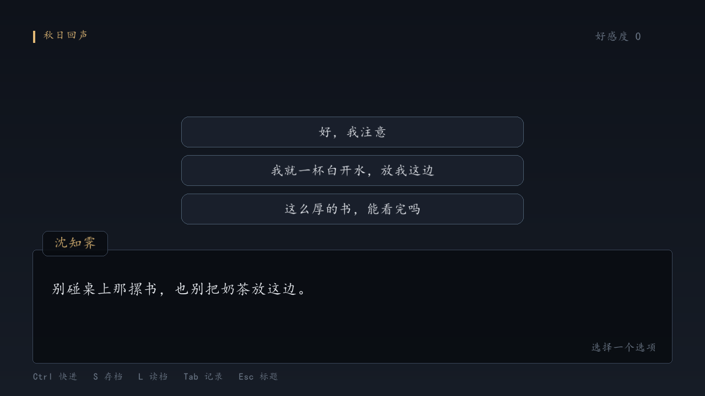
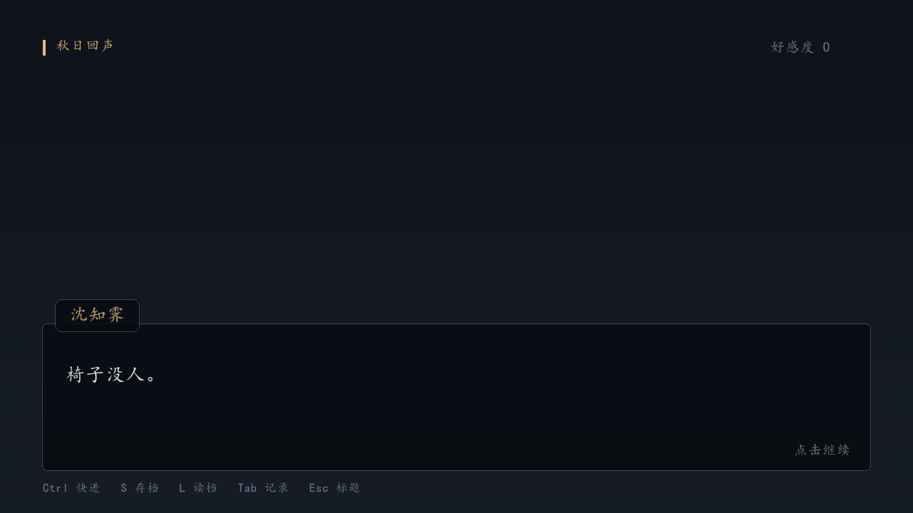

# 秋日回声 — C 语言 Galgame 引擎

[](https://github.com/Herta-hiro/SCU-Project-galgame/actions/workflows/ci.yml)

课程作业演示项目。纯 C + raylib，自研剧本格式，支线对话由大模型生成。
第一章场景：**成都 · 四川省图书馆三楼社科区**；女主：**沈知霁**（历史系大三，高冷慢热）。

| 标题 | 选项 | 对话 |
|---|---|---|
|  |  |  |

## 编译运行

```sh
sh build.sh          # MSYS2 UCRT64 的 gcc
./gal.exe            # 或直接双击 gal.exe / run.bat
```

依赖：MSYS2 UCRT64 的 gcc 与 raylib（`pacman -S mingw-w64-ucrt-x86_64-raylib`）。

运行期需要 `libraylib.dll`、`glfw3.dll`、`libwinpthread-1.dll`，已经放在项目根目录，
所以双击就能开，不依赖 PATH。

改完剧本/角色卡先跑一遍校验（会调 `gal.exe --check`，所以先编译）：

```sh
sh build.sh && python tools/check_script.py
```

## 操作

| 界面 | 按键 | 作用 |
|---|---|---|
| 标题 | 鼠标 / ↑↓ / 回车 | 开始新游戏、继续、退出 |
| 游戏 | 左键 / 空格 / 回车 | 推进；文字未打完时先补全 |
| 游戏 | Ctrl（按住） | 快进：已读行直接跳，未读行快速显示后自动推进 |
| 游戏 | S | 打开存档界面 |
| 游戏 | L | 打开读档界面 |
| 游戏 | Tab | 查看对话记录 |
| 游戏 | V | 开/关台词配音 |
| 游戏 | M | 开/关雨声环境音 |
| 自由输入 | Enter | 把这句话说出口（交给 AI 生成她的反应） |
| 自由输入 | Ctrl+V | 粘贴（中文建议在别处打好再粘，见「自由对话」） |
| 自由输入 | Esc | 取消 |
| 游戏 | Esc | 回到标题 |
| 存档/读档 | 鼠标 / 1 2 3 / Esc | 选槽位或返回 |
| 对话记录 | 滚轮 / ↑↓ / PgUp / PgDn | 翻页 |
| 对话记录 | Esc / Tab / 右键 | 返回 |

## 接入大模型

两种方式，任选其一：

1. 环境变量 `DEEPSEEK_API_KEY`
2. 在 `data/ai.conf` 里写（参考 `data/ai.conf.example`）：

```
key=sk-xxxxxxxx
model=deepseek-chat
```

填好 key 之后想临时回到离线，**不用把 key 删掉**：

- 游戏内「API Key 设置」里点「切到离线」
- 或者 `data/ai.conf` 里加一行 `offline=1`
- 或者启动时加 `--offline` / 设环境变量 `GAL_OFFLINE=1`

离线时用角色卡里按好感阶段写好的台词，流程完整，不发任何网络请求。
三种方式都验证过：`offline=1` 走离线台词，`offline=0` 才会真的发请求。

`model` 填 `deepseek-chat`。**不要填 `deepseek-reasoner`**——那个会先输出一大段思维链再给结果，
一轮要十几秒，而且推理内容会混进台词里。游戏要的是「立刻接话」，不是「想清楚再答」。

没配置也不会崩：按角色卡里 `offline0`-`offline4` 的离线台词走，流程照常走完，
内容随好感阶段变化，课堂演示不用等网络。

### 自由对话

**任何等待选择的画面**，选项区最后都会多一个「（自己说一句）」：点开输入框，自己打一句话，
AI 按人设和当前好感现场回应，演完**回到原来的位置**（不会把刚才那一场重演一遍）。
可以反复说，说过的话会进「已知信息」，下一轮她记得。

这个入口**不在剧本里**，是 `ui.c` 自动追加的虚拟选项（索引 = `choice_count`）：
不占 `Node.choices`、不受 `MAX_CHOICES` 限制，也不用给每个节点补一行。
剧本里写 `-> （自己说一句）|@input` 仍然认，效果一样，但没必要。

- 输入上限约 50 个汉字（受 `Choice.prompt` 的 160 字节限制）
- **中文输入建议 Ctrl+V 粘贴**：raylib 不处理输入法，收得到 IME 提交的字符但**不显示候选窗**，
  盲打很难用。在记事本/微信里打好一句话复制过来最省事
- 自由发言没有剧本兜底值，离线时按 0 结算（不奖不罚），在线时全看模型的「判定」
- 生成成功会弹「AI 现场生成」，命中缓存弹「读取缓存」，一眼能看出这次是哪种
- **自由说的话不进缓存**：同样一句说两次，两次都是现场重新生成。
  剧本里预设的 AI 分支才缓存（固定台词，秒出且可复现）

**自由说话不推进剧情**——它是插话，不是主分支。说完会回到原来的位置，选项还在。
想往下走就点「安静坐着看书，等下一件事」（+2）：好感攒够下一档的门槛，就会自动演下一件事。
说完会弹一句反馈（「她对这句话有反应」/「她没接这句话」/「她只是听着，没什么变化」），
让你知道这句话算不算数；如果那个选项点了没有新事件，会提示「还早 · 再坐着看看」。

**卡住怎么办**：生成中按 **Esc** 取消这一次，回到你开口前的位置，不影响存档和好感。
网络挂起时客户端会在 20 秒后自动放弃（`AI_WAIT_LIMIT`），curl 自己也有 20 秒超时。
两次请求不会叠在一起——上一次没结束就再点，会提示「稍等一下」并立即恢复界面。

### 好感怎么判

**判定是模型给的，引擎只负责取数和放大。**

1. 提示词里带着「当前好感、阶段、地点、最近事件」和**按好感裁过的事件库**，
   每条事件末尾都有「结算：接过道谢+9；说自己带了+3」这样的规则。
2. 模型写完台词后，最后一行只写一个整数：`【判定：+2】`。
3. 引擎 `parse_judgement()` 抠出这个数字，`delta_from_judgement()` 换算：
   **判定 × 3，夹在 ±12**。所以判定 ±1~±4 对应好感 ±3~±12。
4. 模型偶尔漏写状态栏（实测六次一次），这时退回剧本第四列兜底；自由输入没有第四列，就是 0。

**对不上事件库怎么办**：玩家随口说的话往往不落在任何一条事件里，所以提示词给了基准——
具体的帮忙/关心且不越界 `+1`，普通搭话 `0`，冒犯/打探隐私 `-1`，同一类话反复说第二次起减到 0。

想调手感就改这三处：

| 位置 | 作用 |
|---|---|
| `ai.c` 的 `AI_JUDGE_SCALE` / `AI_JUDGE_MAX` | 判定放大倍数和上限（现在 ×3、夹 ±12） |
| `characters.gal` 里每条事件的「结算：……+N」 | 模型照着它打分，改这里等于改判定标准 |
| `ai.c` 提示词的「对不上事件库的时候」那一段 | 自由发言的基准分 |

控制台会打一行账，方便对照：`[AI] 模型 判定=+2 ×3 → +6   好感 30 → 36`

判定本身有 ±1 的抖动（同一个输入多次跑，实测 +1/+2/0 都出现过）——这是模型的固有特性，
temperature 已经压到 0.85。要完全稳定得降到 0，台词会变得死板，不值。

### 速度

一轮实测**平均 1.08 秒**（最快 0.68s，deepseek-chat，5.9KB 请求 ≈ 1800 tokens）。优化：

| 项 | 之前 | 现在 |
|---|---|---|
| 事件库 | 46 条全传（约 11KB） | 按好感裁到 7–14 条（2–2.7KB） |
| 状态栏 | `【好感：55/100｜阶段：2｜记忆：…｜判定：+2，资料相关】` | `【判定：+2】`（省约 40 token） |
| 输出长度 | 3–5 行 | 2–3 行 + `max_tokens: 420` |
| 提示词模板 | 3970 字节 | 3512 字节（分节标题紧凑化） |
| 显示方式 | 等整段生成完，全屏压暗 + 居中「正在生成……」 | **直接长在对话框里**，背景立绘不动 |

事件库裁剪规则见 `ai_trim_events()`：每条事件带「好感5-15」这样的区间，只保留和
`[好感-4, 好感+12]` 有交集的；H1–H9（写的是「第N天」）只在表白线之后传。

生成过程不做任何遮罩：已收到的文字直接替换对话框正文，右下角一个很淡的省略号。
以前是整屏压暗 + 居中一行大字，画面会突然黑一下再弹回来，很跳。

**再快就得动质量了**：剩下的耗时是「1800 token 输入 prefill + 50 token 输出 decode」，
想更快只能减事件库（会丢判定依据）、减台词（会变干）或换更小的模型。

同一份提示词生成过一次会写到 `data/cache/`，第二次直接读缓存。缓存键包含
人设、场景、阶段、玩家台词——改了任何一项都会重新生成，不会读到旧内容。

## 目录

```
gal/
├── build.sh              编译脚本
├── run.bat               双击启动
├── data/
│   ├── main.gal          第一章 + 第二章（hub 自动路由 A1~E2，第一章结尾直接接进去）
│   ├── characters.gal    角色卡（人设、各阶段语气、离线台词、事件库 A1~E2）
│   ├── backgrounds/      背景图（png/jpg，按 @bg 名字找）
│   ├── sprites/          立绘（shenzhiji_*.png，作者提供，共 9 种表情）
│   ├── audio/            雨声环境音（真实录音，见 CREDITS.md）+ 两个界面音效
│   ├── voice/            台词配音（<节点>_<行号>.ogg，tools/gen_voice.py 生成）
│   ├── ai.conf           大模型配置（需自建）
│   └── cache/            生成结果缓存
├── src/
│   ├── game.h            核心数据结构、上限宏、剧本解析入口
│   ├── script.c          剧本解析（单行纯函数 + 加载）、节点跳转
│   ├── character.c/.h    角色卡解析（人设从这里读）
│   ├── contract.h        编译期契约：两处字节上限必须相等，不等就编译失败
│   ├── bg.c/.h           背景图加载与铺屏（@bg 指向 data/backgrounds）
│   ├── sprite.c/.h       立绘加载与摆放（@char 指向 data/sprites）
│   ├── save.c            存档序列化（3 槽位 + 时间戳 + 预览，单一校验入口）
│   ├── ui.c              对话框、打字机、按码点折行
│   ├── menu.c            标题 / 存读档 / 对话记录三个界面
│   ├── ai.c              大模型接口：拼 prompt、SSE 解析、缓存、离线兜底
│   ├── audio.c/.h        雨声环境音与界面音效（缺文件就静默静音）
│   ├── voice.c/.h        台词配音（data/voice 里的 ogg，一行一句，缺文件静默）
│   ├── util.c            UTF-8 工具与对话历史
│   ├── chinese_font_data.c  自动生成的字形码点表（6919 字）
│   └── main.c            主循环与状态机
├── tools/
│   ├── check_script.py   校验器：调引擎查语法，自己查引用与可达性
│   ├── gen_backgrounds.py 背景图生成器（程序绘制，改配色重跑即可）
│   ├── gen_sprites.py    立绘生成器（表情、发型、轮廓光）
│   ├── defringe_sprites.py 立绘去白边（AI 图常见白描边）
│   ├── gen_codepoints.py 重新生成码点表
│   ├── gen_audio.py      合成界面音效（雨声需加 --with-synth-rain 才生成，默认不覆盖真实录音）
│   ├── import_rain.py    把 CC0 真实雨声录音处理成 60 秒无缝循环
│   ├── gen_voice.py      批量生成台词配音（Qwen3-TTS 文芷音色，见下）
│   ├── test_script.c     剧本解析单元测试（64 项，无窗口可跑）
│   └── test_save.c       存档单元测试（22 项，无窗口可跑）
├── docs/
│   ├── 人设对话补写手册.md  ← 补人设和对话看这个
│   ├── 好感分支表.md        好感→事件对照、点击节奏、@once 规则
│   ├── AI提示词-图书馆背景.md
│   └── 草案-低好感事件.md
└── shots/                各界面 / 各阶段预览截图（contact-sheet 见 backgrounds/）
```

## 剧本格式

```
:: 节点id                      开一个新节点
@bg bg_lib_window              本节点背景（data/backgrounds/名字.png 或 .jpg）
@char shenzhiji:look           本节点立绘（角色id:表情，data/sprites/）
@loc 省图三楼社科区靠窗       当前地点，进提示词
@event A2 雨伞忘在前台        最近事件，进提示词（对应角色卡里的事件库）
@offline 沈知霁：……嗯。       本节点的离线兜底台词（没配 key 时播放），多行，优先于角色卡
=> aff>=46 c1_index           自动路由：好感满足就跳过去（条件可写 aff 或 b，b 是距离）
@once A1                      这个事件只演一次，演过之后路由跳过
@toast （图书馆的钟走过一格。）  进这个节点时右上角冒一句提示
@meter bond                   本节点的选项数值记到「距离」上，不加好感（H 段用）
说话人|台词                    一行台词
|台词                         旁白
-> 选项文字|目标|玩家话|好感|场景|条件   分支选项（见下）
# 注释
```

`@bg` 写在 `::` 后面即可；不写就沿用上一个节点的背景，跨场景时才需要换。

选项最多六列，**前四列对普通分支和 AI 分支同义**：

```
-> 选项文字|目标|玩家这句话|好感度增减|本分支场景|出现条件
```

| 列 | 作用 | 省略时 |
|---|---|---|
| 1 | 选项文字 | 必填 |
| 2 | 目标节点；AI 支线写成 `@角色id:返回节点` | 必填 |
| 3 | 玩家真正说出口的那句话，进提示词与「已知信息」 | 空 |
| 4 | **好感度增减**，`+3` / `-5` | `+1` |
| 5 | 场景覆盖，进提示词。**只有 AI 分支会读**，普通分支写了会报错 | 用角色卡 `scene` |
| 2 | 目标节点；AI 支线写 `@角色id:返回节点`；「自己说一句」是引擎自动追加的，这里不用写 | 必填 |
| 6 | 出现条件 `aff>=46` / `aff<=20` / `aff==0`，或 `ev>=6`（已演事件数），可组合 | 一直显示 |

```
-> 好，我注意|after_meet|好，我注意。书我不碰。|+2                      普通分支
-> 你等到闭馆了？|after_exam||+2||aff>=46                              带条件
-> （学期最后一天，收拾东西）|ch2_end_router||0||ev>=6                  演够 6 个事件才出现
-> 我就一杯白开水，放我这边|@shenzhiji:after_meet|我就带了杯白开水。|+3|成都秋雨天。   AI 支线
```

AI 分支的第 4 列是**离线兜底值**：配了 key 时，好感增减由模型输出的「判定」决定（见设计要点），
这一列只在没 key 或模型没写状态栏时生效。普通分支没有这层，第 4 列就是实际值。

第六列不满足时这个选项**不显示**（不是变灰）。

第六列除了好感，还认 `ev`（已经触发过的事件数，数 `seen[]` 里的位）。
`ev>=6` 就是「至少演过 6 个事件才出现」，用来挡住「学期最后一天」这类收尾出口——
否则玩家一进第二章就能点它直接跳结局。两种条件可以写在一起：`aff<86 & ev>=6`。

**好感度对玩家隐藏**：界面上不显示数值，只有她的态度变化。要看数值调试分支时，
把 `src/ui.c` 顶部的 `SHOW_AFFINITY` 改成 1 重新编译，右上角就会出现。

## 角色卡（人设）

人设不再写死在代码里，改 `data/characters.gal` 即可，改完直接运行，**不用重新编译**：

```
:: shenzhiji
name 沈知霁
persona 21岁，成都某高校历史系大三学生……     ← 写多行会自动拼接
rules 严格遵守当前阶段，不提前暧昧……
scene 成都秋雨天，四川省图书馆三楼靠窗座位。
line 玩家坐到对面，把伞收在脚边。
stage0 公事公办，礼貌疏离，不延伸话题。        ← 0-4 五档语气
stage1 记得玩家习惯，偶尔多说半句。
offline0 沈知霁：椅子没人。                   ← 没配 key 时的兜底台词
```

好感度 0-100 自动折算成五个阶段（0-20 / 21-45 / 46-70 / 71-85 / 86-100），
提示词里的「当前好感度 / 当前阶段 / 当前阶段语气」都由引擎填。

字段、字节上限和写作注意事项见 `docs/人设对话补写手册.md`。

## 写完先校验

```sh
sh build.sh && python tools/check_script.py
```

分两层，各管各的，不重复实现同一套规则：

- **语法**问引擎自己（`gal.exe --check`）：列数和每列的含义、好感度写法、字节上限、`@` 指令拼写。
  报错形如 `ERROR: 第 46 行: 第四列是好感度增减，要写成 +2 / -3，实际是「+2|成都…」`。
- **跨行的事**由脚本查：节点引用、id 重复、路由门槛是否从上往下递减、哪些节点走不到、角色卡超长。

有错退出码 1。只查一份剧本：`python tools/check_script.py data/main.gal`。

两个离线单元测试，不依赖 raylib，CI 每次 push 都跑：

```sh
gcc -std=c11 -Isrc tools/test_script.c src/script.c src/save.c src/util.c -o test_script && ./test_script
gcc -std=c11 -Isrc tools/test_save.c   src/script.c src/save.c src/util.c -o test_save   && ./test_save
```

## 台词配音

台词是**离线预生成**的：一句一个文件，放在 `data/voice/<节点>_<行号>.ogg`，
运行时 `start_line()` 直接按「节点 + 行号」找文件播，不做任何实时合成。

- 文件名里的行号 = 引擎的 `line_index`（**旁白也占位**，和 `lines[]` 下标一致）
- 只有剧本里写了说话人的行才配；旁白（`|` 开头的行）不念
- 推进到下一句、切节点、读档、回标题、开存管/记录、按住 Ctrl 快进，都会停掉上一句
- 缺文件 = 这一句没配音，静默跳过，不报错也不卡流程
- 游戏里按 **V** 开关配音；启动前设 `GAL_VOICE=0` 可全局关掉（录屏用），
  设 `GAL_VOICE=1` 则截图/快进模式也出声（验证某一行有没有配到音）

生成（模型在 D 盘，CPU 一句 5~20 秒，59 句约 15 分钟）：

```sh
# 先看会生成哪些、哪些已经有了
python tools/gen_voice.py --list

# 全量；已有的跳过，中途断电重跑只补缺
python tools/gen_voice.py

# 只重做某几个节点
python tools/gen_voice.py --only meet,day2 --force

# 语气对比样本（试听后调 tools/gen_voice.py 里的 TONE_BY_TEXT）
python tools/gen_voice.py --tone-probe
```

音色来自 Qwen3-TTS 的 `wenzhi` speaker（三色绘恋文芷的粉丝微调，模型卡写明不授予权利，
课程演示可用，公开分发/商用要谨慎）。语气按**台词文本**匹配 `TONE_BY_TEXT` 表，
不按行号——剧本里加一行旁白，行号就整体平移，按行号写的表会悄悄错位。

生成器按 `sha1(音色+语气+文本)` 缓存到 `D:\voicelab\voice_cache`，同一句话在多个节点
出现（比如两句「……伞。」）只跑一次模型。

## 调试 / 截图模式

```sh
gal.exe --shot title                     # 标题
gal.exe --shot game                      # 开局
gal.exe --shot choices                   # 选项界面
gal.exe --shot ai --node meet --aff 55   # 取该节点第一条 AI 分支，好感 55（阶段 2）
gal.exe --check                          # 只解析剧本、报告语法错误，返回码非 0 表示有错
gal.exe --prompt --node meet --aff 55    # 不开窗口，把这条分支的完整请求 JSON 写到 prompt-preview.json
gal.exe --skip-sim 6                     # 模拟按住 Ctrl 快进 6 秒，打印落到哪一行
gal.exe --shot node --node h3_sleep --bond 30 --pick 0   # 模拟点第 N 个选项，验证数值与跳转
```

会渲染两帧、存 `shot.png`、自动退出，用来检查排版和看各阶段语气。

## 设计要点

**存档 = 引擎状态的完整序列化。** 只存节点指针、行指针、好感度、已读位图，外加时间戳和一句台词预览。打字机进度这类瞬时状态不入档，读档后从该行开头重新显示，所以读档前后的显示必然一致。

**快进只跳已读。** 每行显示时置位 `read_bits[node][line]`，按住 Ctrl 时只对已读行自动推进。第一遍通读时 Ctrl 只加速打字，不会跳行。

**AI 请求不阻塞界面。** 请求跑在独立线程里，主循环每帧 `ai_poll()` 查状态。生成期间盖一层遮罩提示，输入被屏蔽但窗口不卡。

**三重离线保险。** 缓存 → 角色卡离线台词 → 失败跳过。任何一环断了，支线都能继续推进，不会把玩家卡死在对话框里。

**人设与剧情解耦。** 角色卡管「她是谁、怎么说」，剧本管「发生了什么、好感怎么变」。提示词模板固定，人设、阶段语气、规则全部来自数据文件，换角色只换卡。

**背景按节点切换。** 背景图放 `data/backgrounds/`，剧本用 `@bg 名字` 切；图缺失就退回原来的深色渐变，不会白屏。背景名随存档一起保存，读档后画面和存档时一致。

**立绘按节点切换。** 立绘放 `data/sprites/`，剧本用 `@char 角色id:表情` 切，`@char off` 收人；文件缺失就不画，不会报错。绘制顺序是 背景 → 立绘 → 对话框，所以立绘不会被背景的压暗蒙版盖住，但会被对话框自然压住下半身。

**场景切换有淡入。** `@bg` 一变就整屏从黑场拉起（0.32 秒），普通节点（不改背景）不会闪。截图模式会跳过淡入，否则 `shot.png` 拍到的是第一帧的黑场。

**声音跟着界面走。** 雨声是环境音，60 秒无缝循环、音量 0.22；推进对话和点选项是短促轻响，开存读档 / 对话记录是翻页声。素材由 `tools/gen_audio.py` 合成（雨声是颗粒合成，不是采样素材），没有声卡或文件缺失时静音运行，不报错也不卡流程。按 **M** 可以单独关掉雨声，配音和音效不受影响。

**雨声是真实录音，不是合成。** 第一版用程序合成（滤波噪声 + 颗粒），能做出"像雨"，但做不到"是雨"——差别在 2kHz 以上：真实雨滴撞击录音在 8~16kHz 有 20% 左右的能量，那是雨点打在玻璃和书页上的碎响；合成版这里基本是空的，听感是一条闷闷的"沙——"，很容易被当成底噪。现在换成 CC0 公共领域的真实录音（来源见 `data/audio/CREDITS.md`），由 `tools/import_rain.py` 处理成 60 秒无缝循环：高通去掉车流隆隆、重做循环点、主副两层错开避免 4.6 秒素材的机械感、重采样到 48kHz 直通设备。合成版还留在 `gen_audio.py` 里作离线兜底（`--with-synth-rain`）。

**环境音默认压得很低，且可以单独关。** 雨声 60 秒无缝循环、音量 0.22，起播于标题界面（氛围）。不想听就按 **M** 关掉，配音和音效不受影响——`audio_set_bgm_enabled()` 只压音量不停流，再打开时不会从断点突兀地接上。

**台词配音是离线文件，不是实时合成。** 演出节奏不能被合成速度绑架：CPU 上一句要 5~20 秒，实时合成在演示时必然卡成事故。所以台词全部预生成成 `data/voice/<节点>_<行号>.ogg`，运行时只是 `LoadSound` + `PlaySound`；文件名直接由 `line_index` 拼出来，两边不用维护映射表。缓存 8 句解码结果，来回读档不会反复解 ogg。

**好感度决定进哪个分支。** 第一章结尾选「第二天，还是那张桌子」进第二章 `hub`，用 `=> aff>=46 目标`
做自动路由：进节点时从上往下取第一条命中的，玩家不用点选项。每个事件节点标 `@once`，
演过一次就记进 `seen[]`（随存档保存，v6，416 字节），**跳过已演的继续往下找**（不是停在原地，
否则「好感 86 且 D4 已演」的存档回 hub 会卡死）。低好感 0–4 也有四个一次性小事件
（空位 / 借笔 / 扶书堆 / 推椅子）把好感推到 A1，不会卡住。

**第二章的节奏是配平过的。** 以前每次回到 hub 的选项一加就是 9 点、保底再 +9，从第一章的
43 分到表白线 86 分只要 3 个事件——刚进第二章演三场戏就直接进 D4，体感是「一下就学期末」。
现在回到 hub 的加成缩到 2~4，保底 +2，同样路径要 8 个事件；从 0 分开始要 17 个。
「学期最后一天」也加了 `ev>=6`，必须演够 6 个事件才出现。

**结局分两维：好感定档，距离定深浅。** 好感 ≥86 才进 D4 表白线；46–85 从 hub 的
「学期最后一天」出口走朋友结局；<46 是路过结局。表白线里 H1–H9 的数值记在 `bond` 上，
H9 之后按 `b>=37` 分深浅：bond≥37 时是「明天也来」/「……伞。」，bond 低是原来的两个收束。
表白本身要玩家开口（`d4_confession` → `d4_said`），不开口走 `ch2_end_miss`。

**事件库驱动支线。** 角色卡里的 `events` 一段就是事件库（A1~E2），每条写明触发好感区间、
行为脚本和好感结算，整段进提示词；剧本用 `@event A2 雨伞忘在前台` 告诉模型「刚发生了什么」，
用 `@loc` 告诉它「现在在哪」；每进一个 `@event` 节点，事件名会追加到
「已经发生的事」清单里，所以她记得你借过纸巾、帮她找过索书号。

**模型判定真的会改状态。** 模型回话末尾附一行状态栏【好感｜阶段｜记忆｜判定】，
引擎把「判定」取出来 ×3（夹在 ±12）结算成本场的好感增减，这一行本身对玩家隐藏。
剧本第四列因此退化成**离线兜底**：没配 key、或者模型没写状态栏时，才用它写的数字。
这样在线和离线的推进节奏一致，模型判得再离谱也不会一次推掉一个阶段。

**H 段用「距离」而不是好感。** 好感在阶段 4 早就封顶，H1–H9 的 +2/+3 加在好感上等于没有。
所以 H 段节点标 `@meter bond`，选项数值记进独立的 `bond`（0–100，随存档 v7 保存），
用 `--bond N` 可以在截图模式里预置。

**已知信息滚动记忆。** 玩家选过的话和她回过的第一句会滚动留在 `ai_memory` 里，随每次请求塞进提示词，让支线能接上刚才的语境。

**中文字形预加载。** raylib 的 `LoadFontEx` 在不传码点数组时只加载 95 个 ASCII 字形，中文会显示成方块。这里预生成 6919 个码点（GB2312 全集 + 常用标点符号），加载约 155ms，图集 4096×4096。

## 已知问题

**高 DPI 屏幕上的窗口缩放。** raylib 5.5 与 GLFW 3.4 组合时，GLFW 会把 framebuffer 按系统缩放放大（150% 缩放屏上是 1920×1080），而 raylib 仍按 1280×720 设置 viewport，画面只铺在窗口左下角。已在 `main.c` 中抢先声明进程 DPI 不感知绕过，代价是 Windows 会整体拉伸窗口内容，高缩放比下文字略糊。

**控制台中文乱码。** `printf` 的日志在 GBK 代码页的控制台里显示为乱码，不影响游戏内文字。

## 待完成

- 支线会改好感（模型判定已经接入），但还不能改「这一场演什么」——节点内容是剧本写死的
- 配音只覆盖了固定剧本；AI 支线生成的那几句还没有声音（要做需要常驻 TTS 服务 + 异步请求，
  模型只加载一次，超时 8 秒就跳过）

## 许可

代码按 MIT 许可（见 `LICENSE`）。立绘由项目作者提供；早期试用的 Codel 素材（CC BY 4.0）
已停用并在目录精简时移除（留存于清理前的备份包），若重新启用需按 `data/sprites/CREDITS.md` 署名。
运行时依赖的 raylib / GLFW 各自按其 zlib 许可分发。